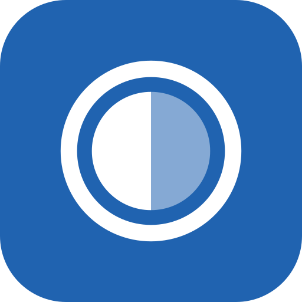

# Reveal

A non-destructive RAW photo editor for Android: develop Sony ARW (and other RAW, JPEG and HEIF)
files on the phone with a colour-managed GPU pipeline, local AI masks, healing and smart presets that
read the photo before applying your style. Offline and private: everything runs on the device.

Reveal is the second stage after [Hoard](https://github.com/henriquefps/hoard): Hoard finds, culls and
copies your photos; Reveal develops the keepers.

**Status:** in development, M0 (foundations). The plan is in [docs/plan/](docs/plan/README.md); decisions
are recorded in [docs/adr/](docs/adr/).

## Build

Requirements: JDK 21 (Android Studio's bundled JBR works), the Android SDK (platforms 37, build-tools,
NDK 28.2.13676358, CMake 3.22.1) and a `local.properties` with `sdk.dir=/path/to/Android/sdk`.

```sh
export JAVA_HOME="/Applications/Android Studio.app/Contents/jbr/Contents/Home"   # macOS example
./gradlew :app:assembleDebug     # debug APK (applicationId dev.hfps.reveal.debug)
./gradlew qa                     # unit tests, screenshot verification, lint, ktlint, detekt
```

A release build is unsigned unless the signing environment variables are set; see [CLAUDE.md](CLAUDE.md)
and [ADR 0001](docs/adr/0001-stack-and-modules.md).

## Licence

Free and open source: [AGPL-3.0-or-later](LICENSE). Third-party components are listed in
[docs/licences.md](docs/licences.md).
